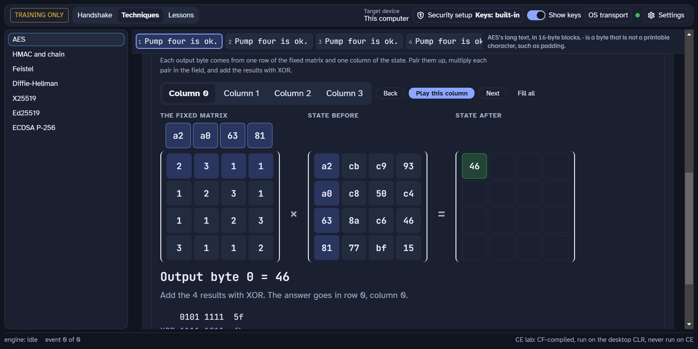

# MMP.NetworkSecurity

A teaching course that opens up network security one message at a time. A learner watches a client and a server agree on keys, prove who they are, and protect each message, on live traffic, with every byte and key on the screen.



## What is in it

1. **A glass-box crypto engine (C#, .NET 10).** AES (ECB, CBC, CTR, GCM), SHA-1, SHA-2, SHA-3, SHAKE, MD5, HMAC, CMAC, HKDF, X25519, Ed25519, ML-KEM-768, RSA, TDES, DH group 14 and DUKPT. Each one is written from its standard so that a learner can step through it. 183 C# files under `src/`.
2. **Protocols as live labs.** TLS 1.3 (with the X25519MLKEM768 hybrid), TLS 1.1 beside TLS 1.3 with the downgrade check, and SSH (host keys, key exchange, user auth, tunnels).
3. **A desktop app (Electron 33, Vue 3).** Twelve lessons: a toy lesson 0 and lessons 1 to 11. Each lesson runs a real lab and has attack buttons. Each attack breaks one thing and names the check that catches it.
4. **Outside referees.** The acceptance suite checks the engine against published vectors (FIPS 197, NIST CAVP, RFC 8448, RFC 7748, RFC 5869, RFC 8032 and others) and runs real handshakes against OpenSSL and Go `crypto/tls` and `x/crypto/ssh`. See `acceptance/README.md`.

## The lessons

| # | Lesson |
|---|---|
| 0 | A toy cipher, to learn the controls |
| 1 | Secrets and locks: AES, modes, and why ECB leaks |
| 2 | Tamper seals: hash, MAC, HMAC, CMAC |
| 3 | Agreeing on a secret in public: X25519, ML-KEM, the hybrid |
| 4 | Who are you: signatures and certificates, with a training CA |
| 5 | TLS 1.3 message by message |
| 6 | A key for each sale: DUKPT, reader side and bank side |
| 7 | The old world: TLS 1.1 beside TLS 1.3, and the downgrade attack |
| 8 | SSH: host keys, key exchange, user auth, tunnels |
| 9 | The bridge: an old device, a gateway, and a modern server |
| 10 | Client proof and permission: mutual TLS, signed tokens, DPoP |
| 11 | Unmanaged space: why a compare must take the same time (C++ and C#) |

The AES part also runs on the web: <https://mmpworks.com/network-security/techniques>.

## Open it

```
pwsh tools/open-app.ps1
```

The script builds what is missing, checks the Electron binary, and opens the app. `pwsh tools/open-app.ps1 -Check` builds and stops before the launch.

## You need

1. .NET 10 and PowerShell 7.
2. Node (the app is Electron 33 with Vue 3). Run `npm install` in `app/` once.
3. [MMP.AsyncProxy](https://github.com/mmpworks/MMP.AsyncProxy) in a folder beside this repo (or set `AsyncProxyRoot`).
4. The .NET Compact Framework 3.5 reference assemblies, for the CF build of the engine. They are Microsoft files and are never committed. Set their folder in `Directory.Build.props`.
5. Visual Studio 2022 (the C++ tools) for lesson 11's native DLL. Without it, lesson 11 shows a named error and every other lesson opens.

## Run the test suite

```
pwsh acceptance/run.ps1 -Clauses All
```

It writes a report under `docs/_runs/`. The suite uses OpenSSL and Go as referees (see `acceptance/README.md`). The X9.24-3 DUKPT vectors are not in this repository. `acceptance/vectors/fetch-x9.ps1` fetches them from x9.org.

A new worktree has no build output. Before the app suite (`npm.cmd run e2e` in `app/`), run from the repo root:

```
dotnet build src/NetSec.Host -c Release
```

Without it, the suite stops at once with `HOST_DLL_STALE: no Release Host at ...`. That stop is intended: the suite runs the Release Host and never builds one.

## Read this first

1. **This is a teaching engine, not a crypto library.** It is built to show the parts. It has no FIPS validation and makes no compliance claims. Never use it to protect real data.
2. All keys in this repository are made-up training keys. Anyone can read them in the source.
3. The attack buttons attack only the course's own loopback labs.
4. The engine is compiled for the .NET Compact Framework and runs on the desktop CLR. It is never run on a CE device.

## Licence

MIT. See [`LICENSE`](LICENSE). Third-party licences are in [`THIRD-PARTY-NOTICES.md`](THIRD-PARTY-NOTICES.md).
